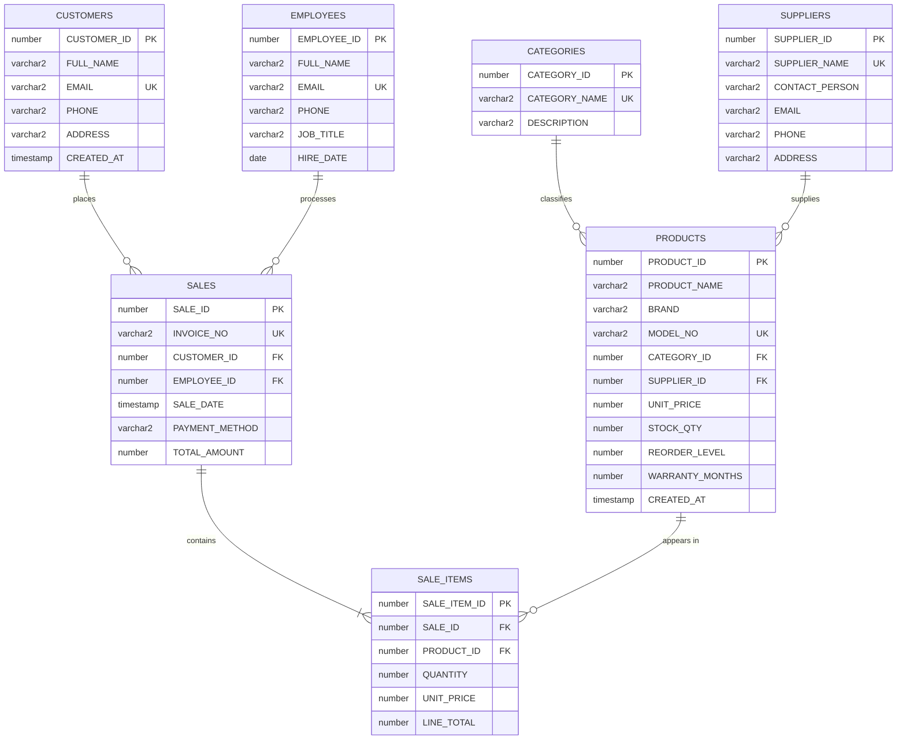

# Electronic Appliance Store Management System

**Database Management Systems (DBMS) — Review 2: Database Implementation & Backend Integration**

| | |
|---|---|
| Student | Sanjiv Shine Fernandas |
| Subject | Database Management Systems |
| Evaluation | Review 2 — Database Implementation & Backend Integration |
| Database | Oracle Database 21c XE, pluggable database `XEPDB1`, schema `appliance_app` |
| Backend | Python Flask, python-oracledb (Thin mode) |
| Frontend | HTML5, CSS3, vanilla JavaScript |
| Environment | Windows local demonstration |

> **Verification disclosure.** This report was produced in an environment with no Oracle Database. Every statement about Oracle behaviour is therefore *designed and statically checked, not live-verified*. Live Oracle tests are labelled **BLOCKED** in the testing matrix (§28). They must be executed locally (README §9) before the live-database criteria are claimed as verified.

\newpage

# Table of Contents

1. Abstract · 2. Introduction · 3. Problem statement · 4. Objectives · 5. Scope and limitations · 6. Functional requirements · 7. Non-functional requirements · 8. Software and hardware requirements · 9. System architecture · 10. Database design · 11. ER diagram · 12. Table descriptions · 13. Keys and constraints · 14. Normalization · 15. Implementation · 16. Flask and Oracle connectivity · 17. CRUD operations · 18. Transactions and inventory consistency · 19. SQL joins, subqueries, aggregations · 20. View, procedure, function, trigger · 21. Frontend · 22. Security · 23. Testing methodology · 24. Verified testing matrix · 25. Results and discussion · 26. Known limitations · 27. Installation summary · 28. Faculty evaluation cross-reference · 29. Conclusion · 30. References

# 1. Abstract

The Electronic Appliance Store Management System is a database-driven web application for a retail appliance shop. A normalized Oracle 21c schema of seven tables stores categories, suppliers, products, customers, employees, sales and sale items. A Flask service layer using python-oracledb provides CRUD for four master entities, transactional multi-item sales with row-level inventory locking, a dashboard and five reports. Oracle-side logic consists of one view, one stored procedure, one stored function and one integrity trigger. Sixteen documented SQL queries demonstrate joins, subqueries, aggregation and analytic features. Security controls include bind variables, CSRF tokens, escaped output, a least-privilege database account and sanitized errors. 76 automated tests ran and passed without Oracle (fake connection); 16 live-Oracle tests are written and BLOCKED pending a local Oracle instance.

# 2. Introduction

Appliance retailers handle high-value items with changing prices and limited stock. Spreadsheet records lead to oversold items, lost price history and inconsistent customer data. A relational database with enforced integrity and transactional sales processing addresses these issues. This project implements that system for Review 2, which evaluates database creation, keys and constraints, sample data, queries, advanced objects, connectivity and CRUD/transactions.

# 3. Problem statement

Design and implement a relational database and web front end that (a) stores store master data without redundancy, (b) records sales with historical prices, (c) prevents negative or oversold inventory even with simultaneous users, and (d) answers business questions (revenue, best sellers, low stock, customer spend).

# 4. Objectives

- Create a normalized (3NF) Oracle schema with full integrity constraints.
- Provide deterministic fictional sample data.
- Provide exactly 16 documented queries and four advanced database objects.
- Connect Flask to Oracle securely with python-oracledb Thin mode.
- Implement CRUD and an atomic sales transaction that never oversells.
- Provide automated tests with honest, status-labelled results.

# 5. Scope and limitations

In scope: master-data CRUD, sales entry/history, inventory reports, restock. Out of scope: user authentication/authorization, returns and refunds, taxes/discounts, purchase orders to suppliers, multi-currency, employee CRUD screens (employees are seeded and selectable on sales). Further limitations in §26.

# 6. Functional requirements

- FR1 Manage products, categories, suppliers, customers (create, list/search, edit, delete).
- FR2 Record a sale with one or more products; totals and prices come from the database.
- FR3 Deduct stock exactly once per sale; reject insufficient stock.
- FR4 Restock a product.
- FR5 Browse sales history and sale details; search by invoice, customer or employee.
- FR6 Dashboard (counts, revenue, low-stock count, recent sales).
- FR7 Reports: inventory status, revenue by month, top products, revenue by category, customer purchase summary.
- FR8 Health endpoint reporting real database connectivity.

# 7. Non-functional requirements

- Integrity: all rules enforced in the database where possible (PK/FK/UNIQUE/CHECK).
- Security: no secrets in code, bind variables, CSRF, output escaping, least privilege.
- Reliability: transactions commit atomically or roll back; connections always closed.
- Usability: responsive layout, empty/error/success states, delete confirmation.
- Maintainability: service-layer separation; tests per layer.
- Portability: Windows 10/11 local setup.

# 8. Software and hardware requirements

| Item | Requirement |
|---|---|
| OS | Windows 10/11 (development sandbox was Linux, used only for non-Oracle checks) |
| Python | 3.11+ (3.13 used in the sandbox) |
| Python packages | Flask, oracledb, python-dotenv, pytest (python-docx, reportlab for report build) |
| Database | Oracle Database 21c XE with `XEPDB1` |
| Tools | SQL*Plus (bundled with XE), PowerShell, a modern browser |
| Hardware | 2+ CPU cores, 4 GB RAM minimum (Oracle XE limit 2 GB database RAM), ~5 GB disk |

# 9. System architecture

```
Browser (HTML/CSS/JS)
   │  HTTP (forms, CSRF token)
   ▼
Flask routes ── app.py (validation of route args, CSRF, error pages, security headers)
   │
   ▼
Service layer ── services/{products,categories,suppliers,customers,employees,sales,reports}.py
   │              services/validation.py  (server-side input rules)
   │              services/database.py    (connection, bind-variable helpers, error translation)
   ▼
python-oracledb (Thin) ── config.py (env vars only)
   ▼
Oracle 21c XE / XEPDB1 / schema appliance_app
   tables · indexes · identity columns · sequence · view · procedure · function · trigger
```

Routes call services only; services own all SQL; the database layer is the only module importing `oracledb`'s connect call.

# 10. Database design

Naming: upper-case Oracle identifiers; `PK_`, `FK_`, `UQ_`, `CK_`, `IX_` prefixes. Surrogate keys use `NUMBER GENERATED ALWAYS AS IDENTITY`. Money columns are `NUMBER(p,2)` (Python `Decimal`, never float). Timestamps use `TIMESTAMP`. Deletion behaviour: every foreign key is `NO ACTION` (restrict) — there is no cascade, so historical sales cannot be destroyed by deleting a customer, employee or product (ORA-02292, reported to users as a friendly 409). Indexes: FK columns (`IX_PRODUCTS_CATEGORY`, `IX_PRODUCTS_SUPPLIER`, `IX_SALES_CUSTOMER`, `IX_SALES_EMPLOYEE`, `IX_SALE_ITEMS_PRODUCT`) and the report filter `IX_SALES_DATE`; PK/UNIQUE constraints supply their own indexes (including `UQ_SALE_ITEMS_LINE (SALE_ID, PRODUCT_ID)` which serves lookups by sale).

# 11. ER diagram



Text alternative (crow's foot: `1` = one, `N` = many):

```
CATEGORIES 1───N PRODUCTS N───1 SUPPLIERS
                    │1
                    N
CUSTOMERS 1───N  SALE_ITEMS N───1 SALES N───1 EMPLOYEES
                                   ▲N
                                   └──────1 CUSTOMERS
(SALES 1───N SALE_ITEMS ; PRODUCTS 1───N SALE_ITEMS ; CUSTOMERS 1───N SALES ; EMPLOYEES 1───N SALES)
```

# 12. Table descriptions and relationships

| Table | Purpose | Key columns |
|---|---|---|
| CATEGORIES | Product groups | PK `CATEGORY_ID`; UK `CATEGORY_NAME` |
| SUPPLIERS | Vendors | PK `SUPPLIER_ID`; UK `SUPPLIER_NAME` |
| PRODUCTS | Central product catalogue and live stock | PK `PRODUCT_ID`; UK `MODEL_NO`; FK `CATEGORY_ID`, `SUPPLIER_ID` |
| CUSTOMERS | Buyers | PK `CUSTOMER_ID`; UK `EMAIL` |
| EMPLOYEES | Staff who process sales | PK `EMPLOYEE_ID`; UK `EMAIL` |
| SALES | One row per invoice | PK `SALE_ID`; UK `INVOICE_NO`; FK `CUSTOMER_ID`, `EMPLOYEE_ID` |
| SALE_ITEMS | Lines of a sale with historical price/quantity | PK `SALE_ITEM_ID`; UK (`SALE_ID`,`PRODUCT_ID`); FK `SALE_ID`, `PRODUCT_ID` |

Relationships (all one-to-many): a category has many products; a supplier supplies many products; a customer has many sales; an employee processes many sales; a sale contains one or more items (≥1 enforced by the service); a product appears in many sale items. A product row is never duplicated by a sale — `SALE_ITEMS` references it and keeps the price and quantity at the time of sale.

# 13. Primary keys, foreign keys and integrity constraints

| Table | Constraints (names as in `schema.sql`) |
|---|---|
| CATEGORIES | `PK_CATEGORIES`, `UQ_CATEGORIES_NAME`, `CATEGORY_NAME NOT NULL` |
| SUPPLIERS | `PK_SUPPLIERS`, `UQ_SUPPLIERS_NAME`, `SUPPLIER_NAME NOT NULL` |
| CUSTOMERS | `PK_CUSTOMERS`, `UQ_CUSTOMERS_EMAIL`, `FULL_NAME/EMAIL/PHONE NOT NULL` |
| EMPLOYEES | `PK_EMPLOYEES`, `UQ_EMPLOYEES_EMAIL`, `FULL_NAME/EMAIL/JOB_TITLE/HIRE_DATE NOT NULL` |
| PRODUCTS | `PK_PRODUCTS`, `UQ_PRODUCTS_MODEL`, `FK_PRODUCTS_CATEGORY`, `FK_PRODUCTS_SUPPLIER`, `CK_PRODUCTS_PRICE (UNIT_PRICE >= 0)`, `CK_PRODUCTS_STOCK (STOCK_QTY >= 0)`, `CK_PRODUCTS_REORDER (>= 0)`, `CK_PRODUCTS_WARRANTY (0..120)` |
| SALES | `PK_SALES`, `UQ_SALES_INVOICE`, `FK_SALES_CUSTOMER`, `FK_SALES_EMPLOYEE`, `CK_SALES_PAYMENT (CASH, CARD, UPI, BANK_TRANSFER)`, `CK_SALES_TOTAL (TOTAL_AMOUNT > 0)` |
| SALE_ITEMS | `PK_SALE_ITEMS`, `UQ_SALE_ITEMS_LINE (SALE_ID, PRODUCT_ID)`, `FK_SALE_ITEMS_SALE`, `FK_SALE_ITEMS_PRODUCT`, `CK_SALE_ITEMS_QTY (> 0)`, `CK_SALE_ITEMS_PRICE (>= 0)`, `CK_SALE_ITEMS_TOTAL (LINE_TOTAL = QUANTITY * UNIT_PRICE)` |

E-mail and phone *format* validation is performed at the application level (`services/validation.py`) as specified. Sequence `SEQ_INVOICE_NO` (start 1000) generates invoice numbers `INV-001000…`; seed invoices use `INV-000001…` so they never collide.

# 14. Normalization analysis (1NF → 3NF)

**1NF.** Every column holds a single atomic value and no table has repeating groups: the "many products in one sale" requirement is modelled by rows in `SALE_ITEMS` rather than columns such as `PRODUCT1, PRODUCT2`. Each table has a primary key. (An address is kept as one atomic text attribute because the application never queries its parts; splitting it would be a refinement, not a 1NF requirement here.)

**2NF.** All tables use a single-column surrogate primary key, so partial dependencies on part of a key cannot occur. For `SALE_ITEMS` the natural candidate key is the composite (`SALE_ID`, `PRODUCT_ID`): `QUANTITY` and `UNIT_PRICE` depend on *both* (how many of which product on which invoice). Product attributes such as name or category are deliberately **not** copied into `SALE_ITEMS`; they would depend on `PRODUCT_ID` alone (a partial dependency) and are kept only in `PRODUCTS`.

**3NF.** No non-key attribute depends on another non-key attribute, with the examples:

| Table | Functional dependencies | Why in 3NF |
|---|---|---|
| CATEGORIES | `CATEGORY_ID → CATEGORY_NAME, DESCRIPTION`; `CATEGORY_NAME → CATEGORY_ID` | Both determinants are candidate keys |
| SUPPLIERS | `SUPPLIER_ID → all`; `SUPPLIER_NAME → all` | Determinants are keys |
| PRODUCTS | `PRODUCT_ID → all`; `MODEL_NO → all` | Category and supplier *names* are not stored — only FKs — so no `PRODUCT_ID → CATEGORY_ID → CATEGORY_NAME` transitive dependency |
| CUSTOMERS | `CUSTOMER_ID → all`; `EMAIL → all` | Determinants are keys |
| EMPLOYEES | `EMPLOYEE_ID → all`; `EMAIL → all` | Determinants are keys |
| SALES | `SALE_ID → all`; `INVOICE_NO → all` | Customer/employee names are not stored (only FKs) |
| SALE_ITEMS | `SALE_ITEM_ID → all`; `(SALE_ID, PRODUCT_ID) → QUANTITY, UNIT_PRICE, LINE_TOTAL` | See the documented exception below |

**Documented, deliberate redundancy (not hidden).**
1. `SALE_ITEMS.LINE_TOTAL = QUANTITY × UNIT_PRICE` is a derived column: `{QUANTITY, UNIT_PRICE} → LINE_TOTAL` has a non-key determinant, so strictly `SALE_ITEMS` is *not* in 3NF. It is stored for audit and fast reporting, and the anomaly risk is removed by `CK_SALE_ITEMS_TOTAL`.
2. `SALES.TOTAL_AMOUNT` equals the sum of its lines' `LINE_TOTAL`. It is computed once by the service from database prices; `V_SALES_SUMMARY.TOTAL_MATCHES` exposes any mismatch. A CHECK cannot span tables, so this one is enforced by the service, not by a constraint.
3. `SALE_ITEMS.UNIT_PRICE` repeats the *name* of `PRODUCTS.UNIT_PRICE` but not its meaning: it is the price at the moment of sale (history), whereas the product price is the current price.

# 15. Implementation details

- `database/schema.sql` — re-runnable DDL via an anonymous block that tolerates only ORA-00955.
- `database/seed.sql` — generated from fixed data; `MERGE` by natural keys; totals computed, not hand-typed.
- `database/queries.sql` — 16 numbered queries; `database/advanced_features.sql` — four objects plus self-rolling-back verification blocks; `database/setup_user.sql` — one-time admin script (password typed at a hidden prompt).
- Python: `config.py`; `services/*`; `app.py` (25 routes); Jinja templates and static assets.

# 16. Flask and Oracle connectivity

`config.load_db_settings()` reads `DB_HOST, DB_PORT, DB_SERVICE_NAME, DB_USER, DB_PASSWORD` from the environment (`python-dotenv` loads `.env` at app start). Values still in `<placeholder>` form count as missing; errors list variable *names* only; `SYS/SYSTEM/SYSDBA/SYSOPER` are refused. `services.database.get_connection()` opens a Thin-mode connection per unit of work (`oracledb.connect(user, password, dsn="host:port/XEPDB1")`) and `connection()` always closes it (rolling back on error). `oracledb.defaults.fetch_decimals = True` returns money as `Decimal`. Diagnostics: `python -m services.database` and `GET /health` — both report success only after `SELECT USER … FROM DUAL` returned. Unavailable Oracle yields HTTP 503 with remediation text and no invented figures.

# 17. CRUD operations

Products, categories, suppliers and customers each have list (search/filter/pagination), create, update (edit form pre-filled via `?edit=<id>`) and delete (POST, confirmation dialog, CSRF). Each service validates input, then runs a parameterized statement in its own short transaction. Constraint errors are translated: ORA-00001 → 409 "already exists", ORA-02291 → 400 invalid reference, ORA-02292 → 409 "referenced by other records", ORA-02290 → 400 rule violation, ORA-30006 → 409 "inventory busy". Restock calls `SP_RESTOCK_PRODUCT`.

# 18. Transaction management and inventory consistency

`services/sales.create_sale` (single connection, no autocommit):

1. Validate ids, payment method and items (non-empty, quantity 1–1000, ≤50 lines; duplicate products merged). No SQL runs if validation fails.
2. Verify the customer and employee exist.
3. For each product **in ascending id order** run `SELECT … FOR UPDATE WAIT 10` (consistent lock order → no deadlock between sales; bounded wait → ORA-30006 instead of hanging).
4. After *all* locks are held, re-check stock; any shortage → `InsufficientStockError` listing the products.
5. Compute each line and the total as `Decimal` from the **locked database rows** (client prices/totals are never accepted — `create_sale` has no price/total parameters).
6. `INSERT` the sale (invoice from `SEQ_INVOICE_NO`, `RETURNING SALE_ID`), `INSERT` each item, `UPDATE PRODUCTS SET STOCK_QTY = STOCK_QTY - :qty` — the **only** place stock is deducted (the trigger deliberately does not touch inventory).
7. One `COMMIT`. Any exception → rollback (the `connection()` context manager and the connection close both enforce it).

Oracle's default `READ COMMITTED` isolation plus row locks prevents overselling: a concurrent buyer blocks on the lock, then re-reads the committed lower stock. `CK_PRODUCTS_STOCK` is the final safety net. Unit tests prove ordering, single commit, rollback and parameterization against a fake connection; the live concurrency proof is integration test INT "concurrent sales cannot oversell" (**BLOCKED** here).

# 19. SQL joins, subqueries and aggregations

| # | Query | Concept |
|---|---|---|
| 1 | In-stock products over ₹20,000 | SELECT, WHERE, ORDER BY |
| 2 | Products in categories matching a pattern | IN subquery |
| 3 | Products with category | INNER JOIN |
| 4 | Products with supplier | JOIN |
| 5 | Customers with their sales (incl. none) | LEFT JOIN |
| 6 | Employee sales performance | LEFT JOIN + COUNT/SUM |
| 7 | Full invoice lines | 5-table JOIN |
| 8 | Products per category | GROUP BY + COUNT |
| 9 | Monthly revenue | SUM/COUNT/AVG by date expression |
| 10 | Categories with revenue > 50,000 | HAVING |
| 11 | Products above average price | Scalar subquery |
| 12 | Products above their category average | Correlated subquery |
| 13 | Products never sold | NOT EXISTS |
| 14 | Top 5 products by units | Aggregation + FETCH FIRST |
| 15 | Customer spend ranking | RANK() analytic |
| 16 | Inventory value and reorder status | CASE KPI |

Status: all 16 statements parse with `sqlglot` (Oracle dialect) — a static syntax check only; **live execution on Oracle is BLOCKED**. With the seed data Q13 should return `VV-TV32` and `AU-EK18`, Q10 should list Televisions (₹139,996), Air Conditioners (₹63,498) and Washing Machines (₹50,998), Q16 flags `CB-AC10` (2 ≤ 3) and `VV-TV55` (4 ≤ 4) as REORDER NOW (expected values derived by hand from the seed; not yet confirmed on Oracle).

# 20. View, procedure, function and trigger

| Object | Purpose | Errors / behaviour |
|---|---|---|
| View `V_SALES_SUMMARY` | One row per sale with customer, employee, line/unit counts and `TOTAL_MATCHES` | Sales without items still appear (LEFT JOIN); used by sales history and dashboard |
| Procedure `SP_RESTOCK_PRODUCT(p_product_id, p_quantity)` | Add stock under a row lock; does not commit (caller owns the transaction) | ORA-20001 invalid quantity, ORA-20002 unknown product; used by the Restock button |
| Function `FN_CUSTOMER_TOTAL_SPEND(p_customer_id)` | Lifetime spend of a customer, 0 if none | ORA-20010 unknown customer; callable from SQL |
| Trigger `TRG_SALES_PROTECT_HISTORY` | Integrity: blocks DELETE of a sale and UPDATE of customer, employee, invoice, date, total, payment | ORA-20030 / ORA-20031; no inventory logic; documented test-cleanup bypass via `CLIENT_INFO` |

Each has example invocation and verification SQL in `advanced_features.sql` (the verification blocks roll back). Live execution: **BLOCKED**.

# 21. Frontend implementation

Server-rendered Jinja templates with a shared `base.html` (navigation, flash messages), responsive CSS (grid, `prefers-color-scheme`, mobile breakpoint, visible focus), and ~60 lines of vanilla JavaScript: delete confirmation (`data-confirm`), dynamic add/remove of sale lines, and a clearly labelled *estimated* total. Every button and form maps to a real route; pagination links preserve filters; empty, error (503/409/400) and success states exist; the page works without JavaScript except the extra sale-line rows. No framework or external dependency; Content-Security-Policy `default-src 'self'` forbids inline scripts.

# 22. Security controls

| Control | Implementation |
|---|---|
| SQL injection | Bind variables only; the only formatted SQL fragments are developer constants (column lists, sorted ORDER BY, the integer lock-wait) |
| CSRF | Per-session token required on every POST/PUT/PATCH/DELETE (form field or `X-CSRF-Token`), constant-time compare |
| XSS | Jinja auto-escaping; no `innerHTML`; CSP |
| Secrets | `.env` git-ignored; `.env.example` placeholders; errors/logs never contain passwords; `repr` of settings hides the password |
| Least privilege | `appliance_app` has six `CREATE …` privileges; config refuses admin users; admin setup is a separate manual script |
| Sessions | HttpOnly, SameSite=Lax, Secure in production |
| Errors | Safe messages, ORA text only in server log |
| Integrity | CHECK constraints reject negative price/stock/quantity; trigger protects history |
| Debug | Off unless `APP_ENV` ≠ production **and** `FLASK_DEBUG=1` |

Not production-secure: there is **no authentication or authorization**, no rate limiting, no audit log of users, HTTPS is not provided by the development server.

# 23. Testing methodology

pytest suites: `test_config` (settings), `test_services` (validation, CRUD and transaction logic against a fake connection that records SQL, parameters, commits, rollbacks and closes), `test_routes` (Flask test client with stubbed services: CSRF, status codes, escaping, headers, health), `test_oracle_integration` (live Oracle, separate test schema, tagged rows, explicit opt-in). Status vocabulary — **PASSED**: executed and passed · **FAILED**: executed and failed · **NOT RUN**: intentionally skipped · **BLOCKED**: required dependency unavailable. Fakes prove application logic, not Oracle semantics (locking, constraint enforcement, PL/SQL), which is why the integration suite exists. Mutation sanity checks: removing the lock-order sort, and adding a mid-sale commit, each made tests fail (then reverted).

# 24. Verified testing matrix

Generated from the actual pytest result file (`docs/test_results.xml`) by `docs/build_reports.py`.

<!-- MATRIX:START -->
| ID | Test description | Expected outcome | Actual outcome | Status | Remarks |
|---|---|---|---|---|---|
| CFG-01 | Valid DB_* variables produce settings and the XEPDB1 DSN | host:port/service DSN, no error | Executed; assertions held | **PASSED** | Pure logic |
| CFG-02 | Missing DB_PASSWORD and DB_HOST are reported by NAME only | ConfigError lists names, leaks no value | Executed; assertions held | **PASSED** | Pure logic |
| CFG-03 | Values copied unchanged from .env.example (<set-locally>) | treated as missing configuration | Executed; assertions held | **PASSED** | Pure logic |
| CFG-04 | DB_USER set to an administrator account (3 parameter sets) | ConfigError (app must use appliance_app only) | Executed; assertions held | **PASSED** | Pure logic |
| CFG-05 | Non-numeric or out-of-range DB_PORT (3 parameter sets) | ConfigError | Executed; assertions held | **PASSED** | Pure logic |
| CFG-06 | repr() of the settings object | does not contain the password | Executed; assertions held | **PASSED** | Pure logic |
| CFG-07 | FLASK_SECRET_KEY missing or placeholder | ConfigError with generation hint | Executed; assertions held | **PASSED** | Pure logic |
| CFG-08 | APP_ENV=production | secure cookies on, debug off even if FLASK_DEBUG=1 | Executed; assertions held | **PASSED** | Pure logic |
| INT-01 | Connect to XEPDB1 as the test application user | connected, user is not SYS/SYSTEM | BLOCKED: live Oracle tests not enabled (set RUN_ORACLE_TESTS=1 and TEST_DB_* variables) | **BLOCKED** | Requires live Oracle test schema |
| INT-02 | USER_TABLES | all 7 required tables exist | BLOCKED: live Oracle tests not enabled (set RUN_ORACLE_TESTS=1 and TEST_DB_* variables) | **BLOCKED** | Requires live Oracle test schema |
| INT-03 | USER_OBJECTS | view, procedure, function, trigger all VALID | BLOCKED: live Oracle tests not enabled (set RUN_ORACLE_TESTS=1 and TEST_DB_* variables) | **BLOCKED** | Requires live Oracle test schema |
| INT-04 | Negative price/stock, duplicate model, bad category FK | ORA-02290 / ORA-00001 / ORA-02291 | BLOCKED: live Oracle tests not enabled (set RUN_ORACLE_TESTS=1 and TEST_DB_* variables) | **BLOCKED** | Requires live Oracle test schema |
| INT-05 | SALE_ITEMS with LINE_TOTAL != QUANTITY*UNIT_PRICE | ORA-02290 | BLOCKED: live Oracle tests not enabled (set RUN_ORACLE_TESTS=1 and TEST_DB_* variables) | **BLOCKED** | Requires live Oracle test schema |
| INT-06 | Delete category/customer/product that history references | ConflictError (ORA-02292 translated) | BLOCKED: live Oracle tests not enabled (set RUN_ORACLE_TESTS=1 and TEST_DB_* variables) | **BLOCKED** | Requires live Oracle test schema |
| INT-07 | Create, read, update, delete a category and customer through the services | each step reflected in DB | BLOCKED: live Oracle tests not enabled (set RUN_ORACLE_TESTS=1 and TEST_DB_* variables) | **BLOCKED** | Requires live Oracle test schema |
| INT-08 | SP_RESTOCK_PRODUCT | +5 stock on success; ORA-20001 for 0, ORA-20002 unknown product | BLOCKED: live Oracle tests not enabled (set RUN_ORACLE_TESTS=1 and TEST_DB_* variables) | **BLOCKED** | Requires live Oracle test schema |
| INT-09 | FN_CUSTOMER_TOTAL_SPEND | 0 before sales, equals sale total after, ORA-20010 for unknown customer | BLOCKED: live Oracle tests not enabled (set RUN_ORACLE_TESTS=1 and TEST_DB_* variables) | **BLOCKED** | Requires live Oracle test schema |
| INT-10 | TRG_SALES_PROTECT_HISTORY | DELETE -> ORA-20030, UPDATE total -> ORA-20031 | BLOCKED: live Oracle tests not enabled (set RUN_ORACLE_TESTS=1 and TEST_DB_* variables) | **BLOCKED** | Requires live Oracle test schema |
| INT-11 | V_SALES_SUMMARY | shows the new sale with correct line/unit counts and TOTAL_MATCHES = 'Y' | BLOCKED: live Oracle tests not enabled (set RUN_ORACLE_TESTS=1 and TEST_DB_* variables) | **BLOCKED** | Requires live Oracle test schema |
| INT-12 | Two-item sale | totals from DB prices (2*100.00+3*49.50=348.50), stock 10->8 and 5->2, items stored | BLOCKED: live Oracle tests not enabled (set RUN_ORACLE_TESTS=1 and TEST_DB_* variables) | **BLOCKED** | Requires live Oracle test schema |
| INT-13 | Quantity above stock | InsufficientStockError; no sale row, stock unchanged | BLOCKED: live Oracle tests not enabled (set RUN_ORACLE_TESTS=1 and TEST_DB_* variables) | **BLOCKED** | Requires live Oracle test schema |
| INT-14 | Valid line + nonexistent product | ValidationError and the valid line's stock is untouched | BLOCKED: live Oracle tests not enabled (set RUN_ORACLE_TESTS=1 and TEST_DB_* variables) | **BLOCKED** | Requires live Oracle test schema |
| INT-15 | Another session holds FOR UPDATE on a product | sale waits then fails with ConflictError (ORA-30006), stock intact | BLOCKED: live Oracle tests not enabled (set RUN_ORACLE_TESTS=1 and TEST_DB_* variables) | **BLOCKED** | Requires live Oracle test schema |
| INT-16 | 8 threads each buy 1 unit of a product with 5 in stock | exactly 5 succeed, 3 InsufficientStockError, final stock 0 | BLOCKED: live Oracle tests not enabled (set RUN_ORACLE_TESTS=1 and TEST_DB_* variables) | **BLOCKED** | Requires live Oracle test schema |
| RTE-01 | Dashboard with stubbed DB figures | 200 and the figures are rendered | Executed; assertions held | **PASSED** | Services stubbed; Flask test client |
| RTE-02 | Oracle unavailable | HTTP 503 error page, no statistics shown | Executed; assertions held | **PASSED** | Services stubbed; Flask test client |
| RTE-03 | Category name containing <script> | rendered escaped, never as live markup | Executed; assertions held | **PASSED** | Services stubbed; Flask test client |
| RTE-04 | POST with no CSRF token | 400 and the service is never called | Executed; assertions held | **PASSED** | Services stubbed; Flask test client |
| RTE-05 | POST with a forged CSRF token | 400 | Executed; assertions held | **PASSED** | Services stubbed; Flask test client |
| RTE-06 | Valid CSRF token + valid form | service called, 303 redirect (post/redirect/get) | Executed; assertions held | **PASSED** | Services stubbed; Flask test client |
| RTE-07 | X-CSRF-Token header instead of form field | accepted | Executed; assertions held | **PASSED** | Services stubbed; Flask test client |
| RTE-08 | GET on delete / update / restock URLs | 405 Method Not Allowed | Executed; assertions held | **PASSED** | Services stubbed; Flask test client |
| RTE-09 | Service raises ValidationError | HTTP 400 with the message | Executed; assertions held | **PASSED** | Services stubbed; Flask test client |
| RTE-10 | Delete of a referenced row | HTTP 409 with friendly message | Executed; assertions held | **PASSED** | Services stubbed; Flask test client |
| RTE-11 | Sale rejected for insufficient stock | HTTP 409 with product detail | Executed; assertions held | **PASSED** | Services stubbed; Flask test client |
| RTE-12 | Forged price/total fields in the sale POST | never forwarded to create_sale | Executed; assertions held | **PASSED** | Services stubbed; Flask test client |
| RTE-13 | Sale form with no product lines | HTTP 400, create_sale never reached | Executed; assertions held | **PASSED** | Services stubbed; Flask test client |
| RTE-14 | Unknown URL -> 404; non-numeric sale id -> 404 | Unknown URL -> 404; non-numeric sale id -> 404 | Executed; assertions held | **PASSED** | Services stubbed; Flask test client |
| RTE-15 | Unexpected exception text with a secret | HTTP 500, page shows a generic message only | Executed; assertions held | **PASSED** | Services stubbed; Flask test client |
| RTE-16 | Any response | CSP, nosniff and frame protection headers set | Executed; assertions held | **PASSED** | Services stubbed; Flask test client |
| RTE-17 | No Oracle configured | /health returns 503 and database=unavailable, never 'ok' | Executed; assertions held | **PASSED** | Services stubbed; Flask test client |
| RTE-18 | health_check reporting success | /health 200 with no secrets in the body | Executed; assertions held | **PASSED** | Services stubbed; Flask test client |
| RTE-19 | Products, customers, sales, sale detail, new sale, reports pages | all render 200 with stubbed data | Executed; assertions held | **PASSED** | Services stubbed; Flask test client |
| SVC-01 | Valid monetary strings (3 parameter sets) | accepted and quantised to 2 decimals | Executed; assertions held | **PASSED** | Fake DB connection - proves SQL/transaction logic, not Oracle behaviour |
| SVC-02 | Negative, non-numeric, 3-decimal, NaN, too-large prices (6 parameter sets) | ValidationError | Executed; assertions held | **PASSED** | Fake DB connection - proves SQL/transaction logic, not Oracle behaviour |
| SVC-03 | Malformed email / phone numbers | ValidationError; valid ones accepted | Executed; assertions held | **PASSED** | Fake DB connection - proves SQL/transaction logic, not Oracle behaviour |
| SVC-04 | Zero, negative, non-integer, None, absurd IDs (6 parameter sets) | ValidationError | Executed; assertions held | **PASSED** | Fake DB connection - proves SQL/transaction logic, not Oracle behaviour |
| SVC-05 | Duplicate products merged, lock order ascending | [(1, 3), (5, 2)] | Executed; assertions held | **PASSED** | Fake DB connection - proves SQL/transaction logic, not Oracle behaviour |
| SVC-06 | Blank form rows ignored; only blanks -> empty sale rejected | ValidationError | Executed; assertions held | **PASSED** | Fake DB connection - proves SQL/transaction logic, not Oracle behaviour |
| SVC-07 | Zero, negative, non-numeric, fractional or huge quantity (5 parameter sets) | ValidationError | Executed; assertions held | **PASSED** | Fake DB connection - proves SQL/transaction logic, not Oracle behaviour |
| SVC-08 | Two-item sale | one commit, DB-priced total 35597.00 (Decimal), stock deducted per item, connection closed | Executed; assertions held | **PASSED** | Fake DB connection - proves SQL/transaction logic, not Oracle behaviour |
| SVC-09 | Items supplied as 3,1,2 | FOR UPDATE issued for 1,2,3 (consistent order -> no deadlock), all before any INSERT | Executed; assertions held | **PASSED** | Fake DB connection - proves SQL/transaction logic, not Oracle behaviour |
| SVC-10 | Request 3 of a product with 2 in stock | InsufficientStockError, nothing inserted or updated, no commit, rolled back | Executed; assertions held | **PASSED** | Fake DB connection - proves SQL/transaction logic, not Oracle behaviour |
| SVC-11 | Product id 999 does not exist | ValidationError, no writes, no commit | Executed; assertions held | **PASSED** | Fake DB connection - proves SQL/transaction logic, not Oracle behaviour |
| SVC-12 | Customer id missing in DB | ValidationError before any product is locked | Executed; assertions held | **PASSED** | Fake DB connection - proves SQL/transaction logic, not Oracle behaviour |
| SVC-13 | Stock UPDATE fails (CHECK violation) after sale+item inserted | ValidationError, rollback, NO commit | Executed; assertions held | **PASSED** | Fake DB connection - proves SQL/transaction logic, not Oracle behaviour |
| SVC-14 | Bad payment method / empty items / bad ids (4 parameter sets) | ValidationError and zero SQL executed | Executed; assertions held | **PASSED** | Fake DB connection - proves SQL/transaction logic, not Oracle behaviour |
| SVC-15 | Every statement uses bind variables; create_sale has no price/total input | no literals from user data in SQL | Executed; assertions held | **PASSED** | Fake DB connection - proves SQL/transaction logic, not Oracle behaviour |
| SVC-16 | advanced_features.sql trigger body | contains no UPDATE of PRODUCTS (single deduction point) | Executed; assertions held | **PASSED** | Fake DB connection - proves SQL/transaction logic, not Oracle behaviour |
| SVC-17 | SQL-injection text in a product name | stays in bind params, never in the SQL string | Executed; assertions held | **PASSED** | Fake DB connection - proves SQL/transaction logic, not Oracle behaviour |
| SVC-18 | Negative price or stock in the form | ValidationError before any SQL | Executed; assertions held | **PASSED** | Fake DB connection - proves SQL/transaction logic, not Oracle behaviour |
| SVC-19 | UPDATE affecting 0 rows | NotFoundError (404) | Executed; assertions held | **PASSED** | Fake DB connection - proves SQL/transaction logic, not Oracle behaviour |
| SVC-20 | ORA-02292 on delete | ConflictError with friendly text, no ORA code/constraint name leaked | Executed; assertions held | **PASSED** | Fake DB connection - proves SQL/transaction logic, not Oracle behaviour |
| SVC-21 | ORA-00001 on insert | ConflictError (409) with generic message | Executed; assertions held | **PASSED** | Fake DB connection - proves SQL/transaction logic, not Oracle behaviour |
| SVC-22 | Listener down (ORA-12541) | DatabaseUnavailableError (503) without host/user/password details | Executed; assertions held | **PASSED** | Fake DB connection - proves SQL/transaction logic, not Oracle behaviour |
| SVC-23 | Restock 10 units | SP_RESTOCK_PRODUCT called with (id, qty), exactly one commit | Executed; assertions held | **PASSED** | Fake DB connection - proves SQL/transaction logic, not Oracle behaviour |
| SVC-24 | Procedure raises ORA-20002 | NotFoundError, rolled back | Executed; assertions held | **PASSED** | Fake DB connection - proves SQL/transaction logic, not Oracle behaviour |
| SVC-25 | oracledb.connect raising ORA-01017 (bad login) | DatabaseUnavailableError, no credentials in message | Executed; assertions held | **PASSED** | Fake DB connection - proves SQL/transaction logic, not Oracle behaviour |
| SVC-26 | No DB configured | health_check returns (False, message) - never claims success | Executed; assertions held | **PASSED** | Fake DB connection - proves SQL/transaction logic, not Oracle behaviour |

Totals by pytest case: BLOCKED 16, PASSED 76
<!-- MATRIX:END -->

**Other checks executed (sandbox: Linux, Python 3.13, no Oracle)**

| Check | Command | Result |
|---|---|---|
| Python compilation | `python -m compileall -q app.py config.py services tests` | PASSED |
| JavaScript syntax | `node --check static/js/app.js` | PASSED |
| Query count | `grep -c "^-- Query [0-9]*:" database/queries.sql` | 16 — PASSED |
| SQL static parse | `sqlglot` (Oracle dialect) over 16 queries and 7 seed MERGE statements | PASSED (syntax only; PL/SQL scripts not parsed — NOT RUN) |
| Flask smoke | `python app.py` then `GET /health`, `GET /products`, `POST /categories` without token | 503, 503, 400 as designed — PASSED |
| Connection diagnostic | `python -m services.database` with an unreachable listener | exit 1, sanitized message, no secrets — PASSED |
| Secret scan | recursive grep for credential-like assignments | only obviously fake test dummies; PASSED |
| Live Oracle: schema, seed, queries, PL/SQL, integration tests | see README §7, §9 | **BLOCKED** — no Oracle instance in the authoring environment |

# 25. Results and discussion

Everything that can run without Oracle ran and passed: configuration rules, validation, service logic including the full sale transaction path (lock order, stock re-check, single commit, rollback on failure), error translation (no leakage of credentials or ORA internals), route behaviour (CSRF, 400/404/409/503 statuses, XSS escaping, security headers, honest health reporting). The design choice of one deduction point (service) and sorted row locks gives deterministic concurrency behaviour that is straightforward to test. What remains unproven until run on Oracle: syntax acceptance of the DDL/PL/SQL scripts, actual constraint and trigger behaviour, the expected query results quoted in §19, and the concurrency tests. These are exactly the BLOCKED rows above.

# 26. Known limitations

- No authentication/authorization or per-user audit trail.
- Not verified on a live Oracle instance by the authoring environment (BLOCKED items).
- `SALES.TOTAL_AMOUNT` ↔ line totals consistency is service-enforced, not a constraint; `LINE_TOTAL` is a documented derived column.
- Trigger contains a test-cleanup bypass that should be removed for production-style use.
- No returns, discounts, taxes, multi-currency; employees have no CRUD screen.
- `LIKE` searches treat `%`/`_` as wildcards; per-request connections (no pool) are adequate for a demo, not for load.
- The seed is first-run oriented: it never overwrites changed rows, so edits to seeded products persist.

# 27. Installation and execution summary

See README §4–§9. In brief (PowerShell): create `appliance_app` once as admin with `database\setup_user.sql`; `py -3.11 -m venv .venv`; activate; `pip install -r requirements.txt`; copy `.env.example` to `.env` and fill in the password and a generated secret key; run `schema.sql`, `advanced_features.sql`, `seed.sql` with `sqlplus appliance_app@localhost:1521/XEPDB1 @database\<file>.sql`; `python -m services.database`; `python -m pytest tests -v`; `python app.py`; open `http://127.0.0.1:5000`.

# 28. Faculty evaluation cross-reference

| # | Criterion | Where implemented | How to demonstrate | Verification status |
|---|---|---|---|---|
| 1 | Database and table creation | `database/schema.sql`, `setup_user.sql`, README §5–§7 | Run scripts; `SELECT table_name FROM user_tables` | Scripts written; live run **BLOCKED** |
| 2 | Keys and constraints | PK/FK/UQ/NOT NULL/CHECK in `schema.sql`; §13 | `user_constraints` query; demo_guide §2 failing inserts | Live enforcement **BLOCKED** (integration tests INT-04/05/06 exist) |
| 3 | Meaningful sample data | `database/seed.sql` (7 tables, 8 multi-item sales) | demo_guide §3 | Statically parsed; live load **BLOCKED** |
| 4 | Joins, subqueries, aggregations | `database/queries.sql` — exactly 16 | Run file; demo_guide §4 | Count and syntax checked; live results **BLOCKED** |
| 5 | Advanced database features | `database/advanced_features.sql` (view, procedure, function, trigger) | Verification blocks; demo_guide §5 | Live **BLOCKED** (integration tests exist) |
| 6 | Backend–database connectivity | `config.py`, `services/database.py`, `/health`, `python -m services.database` | demo_guide §6 | Config/error handling PASSED (unit); real connection **BLOCKED** |
| 7 | CRUD and transactions | `services/*.py`, `app.py`, `templates/*`, `services/sales.py` | UI workflow; demo_guide §7–§8 | Logic PASSED with fakes; Oracle transaction/locking **BLOCKED** |

No criterion is claimed as live-verified.

# 29. Conclusion

The project delivers a normalized seven-table Oracle design, deterministic data, sixteen documented queries, four PL/SQL-side objects, a layered Flask application with an atomic, lock-ordered sales transaction, and a status-honest test suite. All checks that can run without Oracle pass; the live Oracle checks are ready and must be executed on the student's Windows machine to complete verification for the faculty review.

# 30. References

- Oracle Database 21c Documentation: SQL Language Reference; PL/SQL Language Reference; Database Concepts (data concurrency and consistency).
- python-oracledb documentation, <https://python-oracledb.readthedocs.io/>.
- Flask documentation, <https://flask.palletsprojects.com/>.
- OWASP Cheat Sheet Series: SQL Injection Prevention; Cross-Site Request Forgery Prevention.
- Elmasri, R. and Navathe, S., *Fundamentals of Database Systems*, Pearson — normalization chapters.
