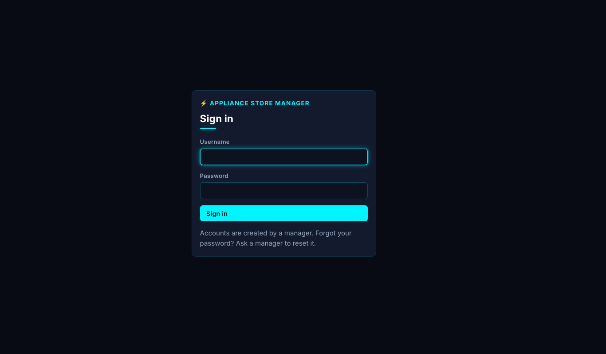
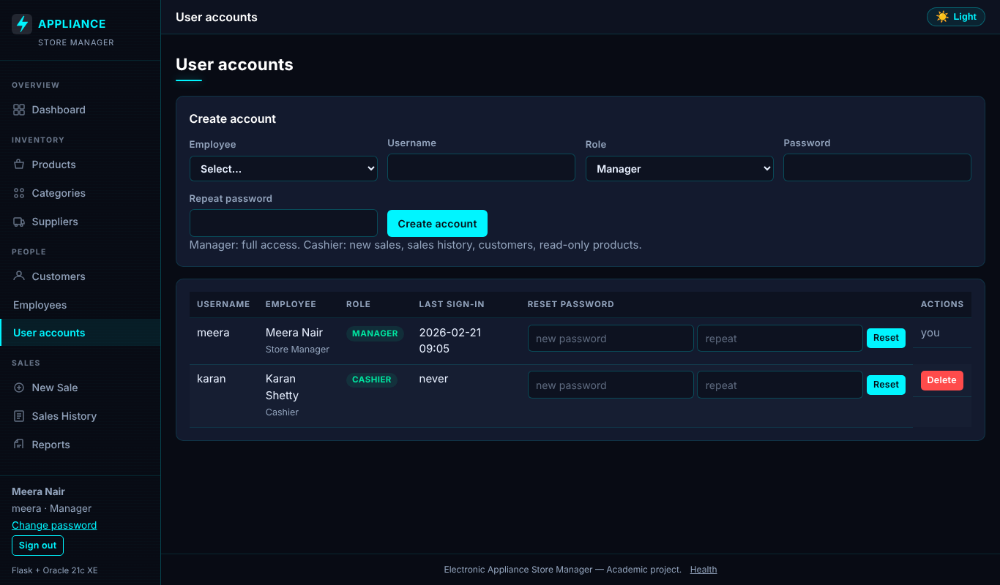
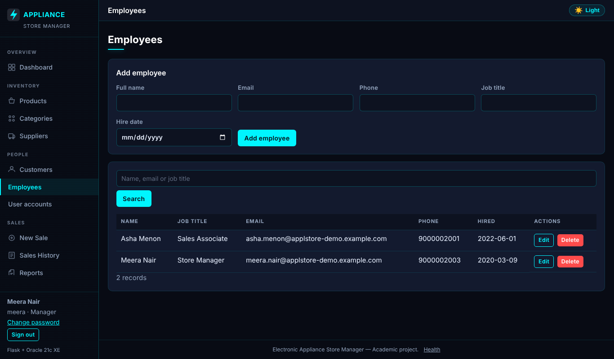
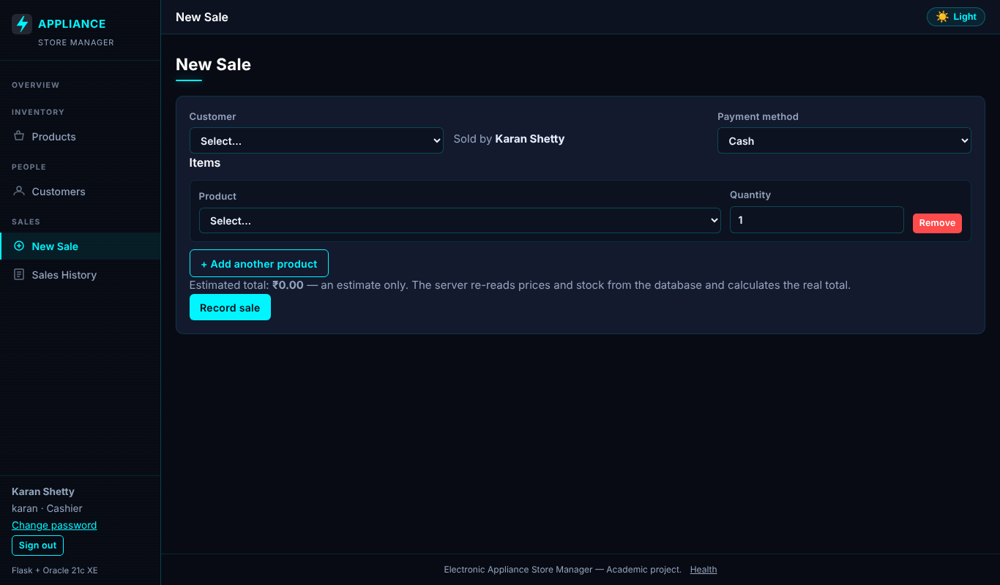
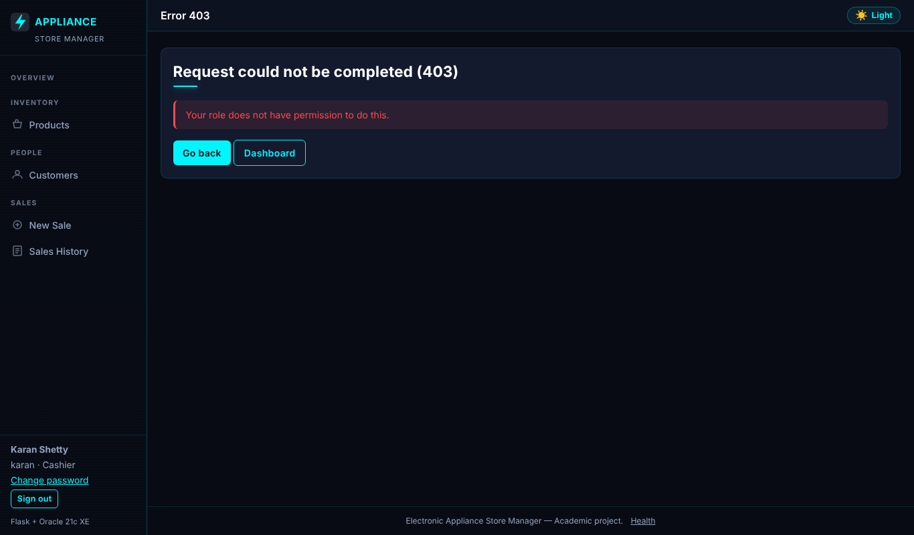

# Electronic Appliance Store Management System — DBMS Review 3 Report

**Student:** Sanjiv Shine Fernandas · **Stack:** Flask, python-oracledb (Thin), Oracle Database 21c XE (`XEPDB1`), HTML/CSS/JavaScript, pytest

> **Verification disclosure.** The code was written in an environment without Oracle. On 2026-10-22 the student ran the 19 live integration tests on a real Oracle Database 21c XE (separate test schema): **19 PASSED** (14.04 s), and executed all 16 queries of `queries.sql` without error. These live results were transcribed from the student's console output into the test matrix; the authoring environment did not produce them. The offline suite (155 tests) was run by the authoring environment; the throttle redesign (§5) was added after the live run and is covered by offline tests only (the live tests do not touch it). **Not verified:** a recorded browser walkthrough of every role scenario, HTTPS deployment, multi-process behaviour of the login throttle, load testing.

# 1. Abstract

Review 2 delivered the Oracle schema, queries, PL/SQL objects and the backend. Review 3 completes the final web application: sign-in with two roles (Manager and Cashier), employee and user-account management, role-aware navigation, security hardening, a production-style launcher and a deployment guide. The database grows from seven to eight tables (`USERS`, in a separate script `auth.sql`). Every page except sign-in and the health check is protected by a default-deny gate.

# 2. Scope of Review 3 and criteria map

| Criterion | Implementation | Evidence | Status |
|---|---|---|---|
| Completion of all proposed functionalities | CRUD for products, categories, suppliers, customers, employees and user accounts; sales, restock, reports, dashboard | Sidebar pages; `app.py` routes | Offline tests PASSED; sale/CRUD service paths PASSED live (INT-07, INT-12..16, INT-19) |
| Frontend–backend–database integration | Jinja forms → Flask routes → `services/*` → python-oracledb → Oracle; atomic sale with row locks | README §8; live tests | PASSED live |
| User interface and usability | Dark/light cyberpunk theme, responsive layout, role-filtered navigation, confirmations, clear errors | Screenshots in §9 (sample data) | Rendered in a browser; not a recorded test |
| Authentication and role-based access | `/login`, `/logout`, scrypt password hashes, `USERS` table, Manager/Cashier roles, default-deny gate, login throttle, 8-hour sessions, change password, `manage.py` bootstrap | `tests/test_auth.py`; live tests INT-17, INT-18 | Offline PASSED; table and hashing PASSED live |
| Database correctness and integrity | 8 tables, PK/FK/UNIQUE/CHECK, no-cascade FKs, protective trigger, atomic sale transaction | `schema.sql`, `auth.sql`; INT-02..06 | PASSED live |
| Search, filtering, reports, dashboard | Search/filter/pagination; dashboard; five reports | `/products?q=`, `/reports` | Offline PASSED; the 16 queries ran live |
| Error handling and basic security | Bind variables, CSRF on every POST, escaped output, CSP, safe error pages, hashed passwords, least-privilege DB user | `test_routes.py`, `test_auth.py` | Offline PASSED |
| Testing and demonstration | pytest (unit, route, auth, live Oracle); `docs/demo_guide.md` | §12 | 155 offline + 19 live PASSED |
| Project documentation | README, `docs/deployment.md`, demo guide, Review 2 report, this report | — | Delivered |

# 3. Architecture

```
Browser → Flask routes (app.py: login gate, CSRF, roles) → services/*.py (all SQL) → python-oracledb → Oracle XEPDB1
```

Routes never contain SQL. Stock is deducted in exactly one place (`services/sales.create_sale`), never in a trigger. Configuration comes only from environment variables (`.env`, git-ignored); the application connects only as `appliance_app` and `config.py` rejects SYS/SYSTEM.

# 4. Database design

The seven Review 2 tables (`CATEGORIES, SUPPLIERS, PRODUCTS, CUSTOMERS, EMPLOYEES, SALES, SALE_ITEMS`) are unchanged. `database/auth.sql` adds an eighth table:

| Column | Type / rule |
|---|---|
| `USER_ID` | identity primary key |
| `USERNAME` | unique, CHECK lower-case |
| `PASSWORD_HASH` | scrypt hash (never the password) |
| `ROLE` | CHECK IN ('MANAGER','CASHIER') |
| `EMPLOYEE_ID` | UNIQUE foreign key to `EMPLOYEES` (one login per employee) |
| `CREATED_AT`, `LAST_LOGIN` | timestamps |

Run order: `schema.sql`, `advanced_features.sql`, `seed.sql`, `auth.sql`. `auth.sql` was loaded and its six named constraints confirmed in the student's Oracle instance; live test INT-17 checks that the role, username and unique-employee rules are enforced.

# 5. Authentication and access control

- **No default accounts.** The first manager is created from the server with `python manage.py create-user USERNAME ROLE EMPLOYEE_EMAIL` (hidden password prompt). Passwords need at least 10 characters.
- **Default deny.** A `before_request` gate requires sign-in for every endpoint except `login`, `health` and `static`. Endpoints a cashier may use are listed explicitly (`CASHIER_ENDPOINTS`); everything else is manager-only. A test enumerates every registered route.
- **Sessions.** 8 hours, `HttpOnly`, `SameSite`; `Secure` when `APP_ENV=production` (HTTPS only). Sign-out is a POST.
- **Throttle** (`services/throttle.py`). Two sliding 5-minute limits: 5 failures per (username, client address) and 20 per client address across all usernames. Another address is never affected, so a user cannot be locked out from elsewhere. Memory is capped at 10,000 entries (expired, then oldest dropped); it is thread-safe. HTTP 429 carries `Retry-After` and the block is logged. Behind a reverse proxy, `TRUSTED_PROXIES=<n>` applies Werkzeug `ProxyFix` for exactly n proxies (default 0: `X-Forwarded-For` is ignored, so it cannot be spoofed).
- **Open-redirect protection.** After sign-in `next=` accepts only same-site paths; control characters, backslashes and `//` are rejected.

| | Manager | Cashier |
|---|---|---|
| Sales (new, history, detail) | yes | yes; the seller is always the signed-in employee |
| Products | CRUD + restock | view |
| Customers | CRUD | list, add, edit |
| Dashboard, reports, categories, suppliers, employees, user accounts | yes | no (HTTP 403) |
| Change own password | yes | yes |

Manager accounts cannot be deleted in the application, which also means nobody can delete their own account or the last manager. A cashier account can be deleted by a manager.

# 6. Employee and user management

Managers add, edit and delete employees (referenced rows are protected by the RESTRICT foreign keys and reported as a clear 409 message) and create sign-in accounts for employees who do not yet have one. The user-accounts page marks the signed-in account as "you" and manager rows as "protected". Role changes take effect at the next sign-in.

# 7. Atomic sales (carried over, verified live)

The sale transaction locks the product rows in ascending id order (`SELECT … FOR UPDATE WAIT`), re-checks stock, inserts the sale and its items with prices read from the database, deducts stock once and commits once; any error rolls everything back. Live tests confirmed: a two-item sale deducts stock and uses database prices (INT-12), insufficient stock changes nothing (INT-13), an invalid line rolls back the whole sale (INT-14), a held row lock makes the sale wait and fail cleanly (INT-15) and eight concurrent buyers of five units give exactly five successes (INT-16).

# 8. Security hardening

| Finding | Fix |
|---|---|
| `next=/<TAB>/evil.example` became the external URL `//evil.example`; a newline caused HTTP 500 | `safe_next` rejects control characters, backslashes and `//` |
| `manage.py` printed a traceback on missing configuration | Prints `FAILED: …` and exits with status 1 |
| `/health` revealed the database user, service name and configuration variable names | Status-only response `{"app","database"}` with HTTP 200 or 503; the detail goes to the server log |
| Flask default session lifetime is 31 days | `PERMANENT_SESSION_LIFETIME` set to 8 hours |
| Oracle returns identity values as `Decimal`; the session cookie stored them as text, so the "cannot delete yourself" check could be bypassed and a Delete button appeared on one's own row | All user and employee ids are cast to `int`; regression tests added |
| Previously used database passwords | Treated as compromised; rotate (`ALTER USER … IDENTIFIED BY`), keep only in `.env` |

The Decimal defect was found by the student during manual testing, after the offline tests had passed. It is a concrete example of why the fake-database tests do not replace running against Oracle.

# 9. User interface

Screenshots below use the real templates rendered with sample data (no database), so they show layout and role behaviour, not live records.











# 10. Deployment

`python serve.py` runs the application under waitress (8 threads, no debug), listening on `127.0.0.1:8000` unless `HOST`/`PORT` are set. For anything beyond localhost, terminate HTTPS in a reverse proxy and set `APP_ENV=production`. `docs/deployment.md` covers setup, Task Scheduler start-up, backups (`expdp`/RMAN), password rotation, removing a manager with SQL and the health endpoint. HTTPS deployment was **not** exercised.

# 11. Known limitations

- Login throttle: state is per process, so it resets on restart and is not shared between several workers (an Oracle-backed store would be the next step); there is no progressive delay; and the address-wide limit can block everyone behind one shared (NAT) address for up to 5 minutes after 20 failures.
- No self-registration, password-reset e-mail or multi-factor sign-in; a manager resets passwords.
- Role and account changes apply at the next sign-in (sessions last 8 hours).
- No connection pool; single-currency display; no returns, tax or discount model.
- The history-protection trigger contains a documented test-cleanup bypass (`CLIENT_INFO = 'ITEST_CLEANUP'`) that should be removed for production.
- Live results come from one single-user run on one machine.

# 12. Testing

Suites: `test_config`, `test_services` (fake connection), `test_routes` (Flask test client), `test_auth` (every route requires sign-in, role matrix, open redirect, hashing), `test_throttle` (fake-clock throttle limits, bounded memory, proxy header handling) and `test_oracle_integration` (live Oracle, separate test schema, tagged `ITEST-` rows removed afterwards). Status vocabulary — **PASSED**: executed and passed · **FAILED**: executed and failed · **NOT RUN**: intentionally skipped · **BLOCKED**: dependency unavailable.

On the first live run 18 of 19 tests passed; the one failure (`test_function_customer_total_spend`) was a mistake in the test itself (a bind variable named like a helper argument), not in the application or database. It was fixed and the whole suite then passed 19 of 19.

<!-- MATRIX:START -->
| ID | Test description | Expected outcome | Actual outcome | Status | Remarks |
|---|---|---|---|---|---|
| CFG-01 | Valid DB_* variables produce settings and the XEPDB1 DSN | host:port/service DSN, no error | Executed; assertions held | **PASSED** | Pure logic |
| CFG-02 | Missing DB_PASSWORD and DB_HOST are reported by NAME only | ConfigError lists names, leaks no value | Executed; assertions held | **PASSED** | Pure logic |
| CFG-03 | Values copied unchanged from .env.example (<set-locally>) | treated as missing configuration | Executed; assertions held | **PASSED** | Pure logic |
| CFG-04 | DB_USER set to an administrator account (3 parameter sets) | ConfigError (app must use appliance_app only) | Executed; assertions held | **PASSED** | Pure logic |
| CFG-05 | Non-numeric or out-of-range DB_PORT (3 parameter sets) | ConfigError | Executed; assertions held | **PASSED** | Pure logic |
| CFG-06 | repr() of the settings object | does not contain the password | Executed; assertions held | **PASSED** | Pure logic |
| CFG-07 | FLASK_SECRET_KEY missing or placeholder | ConfigError with generation hint | Executed; assertions held | **PASSED** | Pure logic |
| CFG-08 | APP_ENV=production | secure cookies on, debug off even if FLASK_DEBUG=1 | Executed; assertions held | **PASSED** | Pure logic |
| SVC-01 | Valid monetary strings (3 parameter sets) | accepted and quantised to 2 decimals | Executed; assertions held | **PASSED** | Fake DB connection - proves SQL/transaction logic, not Oracle behaviour |
| SVC-02 | Negative, non-numeric, 3-decimal, NaN, too-large prices (6 parameter sets) | ValidationError | Executed; assertions held | **PASSED** | Fake DB connection - proves SQL/transaction logic, not Oracle behaviour |
| SVC-03 | Malformed email / phone numbers | ValidationError; valid ones accepted | Executed; assertions held | **PASSED** | Fake DB connection - proves SQL/transaction logic, not Oracle behaviour |
| SVC-04 | Zero, negative, non-integer, None, absurd IDs (6 parameter sets) | ValidationError | Executed; assertions held | **PASSED** | Fake DB connection - proves SQL/transaction logic, not Oracle behaviour |
| SVC-05 | Duplicate products merged, lock order ascending | [(1, 3), (5, 2)] | Executed; assertions held | **PASSED** | Fake DB connection - proves SQL/transaction logic, not Oracle behaviour |
| SVC-06 | Blank form rows ignored; only blanks -> empty sale rejected | ValidationError | Executed; assertions held | **PASSED** | Fake DB connection - proves SQL/transaction logic, not Oracle behaviour |
| SVC-07 | Zero, negative, non-numeric, fractional or huge quantity (5 parameter sets) | ValidationError | Executed; assertions held | **PASSED** | Fake DB connection - proves SQL/transaction logic, not Oracle behaviour |
| SVC-08 | Two-item sale | one commit, DB-priced total 35597.00 (Decimal), stock deducted per item, connection closed | Executed; assertions held | **PASSED** | Fake DB connection - proves SQL/transaction logic, not Oracle behaviour |
| SVC-09 | Items supplied as 3,1,2 | FOR UPDATE issued for 1,2,3 (consistent order -> no deadlock), all before any INSERT | Executed; assertions held | **PASSED** | Fake DB connection - proves SQL/transaction logic, not Oracle behaviour |
| SVC-10 | Request 3 of a product with 2 in stock | InsufficientStockError, nothing inserted or updated, no commit, rolled back | Executed; assertions held | **PASSED** | Fake DB connection - proves SQL/transaction logic, not Oracle behaviour |
| SVC-11 | Product id 999 does not exist | ValidationError, no writes, no commit | Executed; assertions held | **PASSED** | Fake DB connection - proves SQL/transaction logic, not Oracle behaviour |
| SVC-12 | Customer id missing in DB | ValidationError before any product is locked | Executed; assertions held | **PASSED** | Fake DB connection - proves SQL/transaction logic, not Oracle behaviour |
| SVC-13 | Stock UPDATE fails (CHECK violation) after sale+item inserted | ValidationError, rollback, NO commit | Executed; assertions held | **PASSED** | Fake DB connection - proves SQL/transaction logic, not Oracle behaviour |
| SVC-14 | Bad payment method / empty items / bad ids (4 parameter sets) | ValidationError and zero SQL executed | Executed; assertions held | **PASSED** | Fake DB connection - proves SQL/transaction logic, not Oracle behaviour |
| SVC-15 | Every statement uses bind variables; create_sale has no price/total input | no literals from user data in SQL | Executed; assertions held | **PASSED** | Fake DB connection - proves SQL/transaction logic, not Oracle behaviour |
| SVC-16 | advanced_features.sql trigger body | contains no UPDATE of PRODUCTS (single deduction point) | Executed; assertions held | **PASSED** | Fake DB connection - proves SQL/transaction logic, not Oracle behaviour |
| SVC-17 | SQL-injection text in a product name | stays in bind params, never in the SQL string | Executed; assertions held | **PASSED** | Fake DB connection - proves SQL/transaction logic, not Oracle behaviour |
| SVC-18 | Negative price or stock in the form | ValidationError before any SQL | Executed; assertions held | **PASSED** | Fake DB connection - proves SQL/transaction logic, not Oracle behaviour |
| SVC-19 | UPDATE affecting 0 rows | NotFoundError (404) | Executed; assertions held | **PASSED** | Fake DB connection - proves SQL/transaction logic, not Oracle behaviour |
| SVC-20 | ORA-02292 on delete | ConflictError with friendly text, no ORA code/constraint name leaked | Executed; assertions held | **PASSED** | Fake DB connection - proves SQL/transaction logic, not Oracle behaviour |
| SVC-21 | ORA-00001 on insert | ConflictError (409) with generic message | Executed; assertions held | **PASSED** | Fake DB connection - proves SQL/transaction logic, not Oracle behaviour |
| SVC-22 | Listener down (ORA-12541) | DatabaseUnavailableError (503) without host/user/password details | Executed; assertions held | **PASSED** | Fake DB connection - proves SQL/transaction logic, not Oracle behaviour |
| SVC-23 | Restock 10 units | SP_RESTOCK_PRODUCT called with (id, qty), exactly one commit | Executed; assertions held | **PASSED** | Fake DB connection - proves SQL/transaction logic, not Oracle behaviour |
| SVC-24 | Procedure raises ORA-20002 | NotFoundError, rolled back | Executed; assertions held | **PASSED** | Fake DB connection - proves SQL/transaction logic, not Oracle behaviour |
| SVC-25 | oracledb.connect raising ORA-01017 (bad login) | DatabaseUnavailableError, no credentials in message | Executed; assertions held | **PASSED** | Fake DB connection - proves SQL/transaction logic, not Oracle behaviour |
| SVC-26 | No DB configured | health_check returns (False, message) - never claims success | Executed; assertions held | **PASSED** | Fake DB connection - proves SQL/transaction logic, not Oracle behaviour |
| RTE-01 | Dashboard with stubbed DB figures | 200 and the figures are rendered | Executed; assertions held | **PASSED** | Services stubbed; Flask test client |
| RTE-02 | Oracle unavailable | HTTP 503 error page, no statistics shown | Executed; assertions held | **PASSED** | Services stubbed; Flask test client |
| RTE-03 | Category name containing <script> | rendered escaped, never as live markup | Executed; assertions held | **PASSED** | Services stubbed; Flask test client |
| RTE-04 | POST with no CSRF token | 400 and the service is never called | Executed; assertions held | **PASSED** | Services stubbed; Flask test client |
| RTE-05 | POST with a forged CSRF token | 400 | Executed; assertions held | **PASSED** | Services stubbed; Flask test client |
| RTE-06 | Valid CSRF token + valid form | service called, 303 redirect (post/redirect/get) | Executed; assertions held | **PASSED** | Services stubbed; Flask test client |
| RTE-07 | X-CSRF-Token header instead of form field | accepted | Executed; assertions held | **PASSED** | Services stubbed; Flask test client |
| RTE-08 | GET on delete / update / restock URLs | 405 Method Not Allowed | Executed; assertions held | **PASSED** | Services stubbed; Flask test client |
| RTE-09 | Service raises ValidationError | HTTP 400 with the message | Executed; assertions held | **PASSED** | Services stubbed; Flask test client |
| RTE-10 | Delete of a referenced row | HTTP 409 with friendly message | Executed; assertions held | **PASSED** | Services stubbed; Flask test client |
| RTE-11 | Sale rejected for insufficient stock | HTTP 409 with product detail | Executed; assertions held | **PASSED** | Services stubbed; Flask test client |
| RTE-12 | Forged price/total/employee fields in the sale POST | price and total ignored; employee id comes from the login session | Executed; assertions held | **PASSED** | Services stubbed; Flask test client |
| RTE-13 | Sale form with no product lines | HTTP 400, create_sale never reached | Executed; assertions held | **PASSED** | Services stubbed; Flask test client |
| RTE-14 | Unknown URL -> 404; non-numeric sale id -> 404 | Unknown URL -> 404; non-numeric sale id -> 404 | Executed; assertions held | **PASSED** | Services stubbed; Flask test client |
| RTE-15 | Unexpected exception text with a secret | HTTP 500, page shows a generic message only | Executed; assertions held | **PASSED** | Services stubbed; Flask test client |
| RTE-16 | Any response | CSP, nosniff and frame protection headers set | Executed; assertions held | **PASSED** | Services stubbed; Flask test client |
| RTE-17 | No Oracle configured | /health returns 503 and database=unavailable, never 'ok' | Executed; assertions held | **PASSED** | Services stubbed; Flask test client |
| RTE-18 | health_check reporting success | /health 200 with no secrets in the body | Executed; assertions held | **PASSED** | Services stubbed; Flask test client |
| RTE-19 | Products, customers, sales, sale detail, new sale, reports pages | all render 200 with stubbed data | Executed; assertions held | **PASSED** | Services stubbed; Flask test client |
| AUT-01 | Every non-public route requested without signing in | 302 redirect to /login (default deny) | Executed; assertions held | **PASSED** | Flask test client, fake database |
| AUT-02 | POST to a write route without login | redirected, service not called | Executed; assertions held | **PASSED** | Flask test client, fake database |
| AUT-03 | is_allowed over every endpoint | manager: all; cashier: only the documented list | Executed; assertions held | **PASSED** | Flask test client, fake database |
| AUT-04 | Cashier calling manager-only pages/actions (12 parameter sets) | HTTP 403 and no service call | Executed; assertions held | **PASSED** | Flask test client, fake database |
| AUT-05 | Cashier opens New Sale, Sales History, Products (read), Customers | HTTP 200 | Executed; assertions held | **PASSED** | Flask test client, fake database |
| AUT-06 | Cashier views products | no add form, restock or edit/delete buttons rendered | Executed; assertions held | **PASSED** | Flask test client, fake database |
| AUT-07 | Cashier submits a sale with a forged employee_id | create_sale receives the cashier's own employee id | Executed; assertions held | **PASSED** | Flask test client, fake database |
| AUT-08 | Valid credentials | 303 to dashboard (manager) / new sale (cashier); session holds the user; password never stored in session | Executed; assertions held | **PASSED** | Flask test client, fake database |
| AUT-09 | Wrong credentials | HTTP 401, same message for unknown user or bad password, no session | Executed; assertions held | **PASSED** | Flask test client, fake database |
| AUT-10 | 5 failed attempts for one username | 6th attempt gets HTTP 429 even with the right password | Executed; assertions held | **PASSED** | Flask test client, fake database |
| AUT-11 | Login with a next= parameter (8 parameter sets) | only same-site relative paths are followed (no open redirect) | Executed; assertions held | **PASSED** | Flask test client, fake database |
| AUT-12 | Login POST without a CSRF token | HTTP 400, authenticate never called | Executed; assertions held | **PASSED** | Flask test client, fake database |
| AUT-13 | GET /logout rejected; POST /logout with token ends the session | 405 then redirect to login, protected page redirects again | Executed; assertions held | **PASSED** | Flask test client, fake database |
| AUT-14 | Already signed in and opening /login | redirected to the landing page | Executed; assertions held | **PASSED** | Flask test client, fake database |
| AUT-15 | Session lifetime configured and cookie hardening present | 8-hour lifetime | Executed; assertions held | **PASSED** | Flask test client, fake database |
| AUT-16 | Create a user | the INSERT carries a salted hash, never the plain password; username lower-cased | Executed; assertions held | **PASSED** | Flask test client, fake database |
| AUT-17 | Bad username, role, short/mismatched/equal password, bad employee id (7 parameter sets) | ValidationError and no SQL | Executed; assertions held | **PASSED** | Flask test client, fake database |
| AUT-18 | ORA-00001 on user insert | ConflictError (409) | Executed; assertions held | **PASSED** | Flask test client, fake database |
| AUT-19 | Correct password -> user dict and LAST_LOGIN update; wrong password or unknown user -> None | Correct password -> user dict and LAST_LOGIN update; wrong password or unknown user -> None | Executed; assertions held | **PASSED** | Flask test client, fake database |
| AUT-20 | Delete own account / another manager | ConflictError and no DELETE; deleting a cashier works | Executed; assertions held | **PASSED** | Flask test client, fake database |
| AUT-21 | Wrong current password | ValidationError; correct current + valid new -> hashed UPDATE | Executed; assertions held | **PASSED** | Flask test client, fake database |
| AUT-22 | Create an employee | bind variables incl. a real date object; commit once | Executed; assertions held | **PASSED** | Flask test client, fake database |
| AUT-23 | Future/invalid hire date, bad email, missing job title (5 parameter sets) | ValidationError and no SQL | Executed; assertions held | **PASSED** | Flask test client, fake database |
| AUT-24 | Deleting an employee referenced by sales/users (ORA-02292) | ConflictError, safe text | Executed; assertions held | **PASSED** | Flask test client, fake database |
| AUT-25 | Importing serve.py | does not start a server; waitress is installed | Executed; assertions held | **PASSED** | Flask test client, fake database |
| AUT-26 | Manager opens Employees and User accounts | pages render with data and password inputs | Executed; assertions held | **PASSED** | Flask test client, fake database |
| AUT-27 | manage.py list-users with no database configuration | prints 'FAILED: Missing database configuration...' and returns 1 (no traceback) | Executed; assertions held | **PASSED** | Flask test client, fake database |
| AUT-28 | manage.py reset-password | unknown user -> exit 1; known user -> one UPDATE with a hash, never the password | Executed; assertions held | **PASSED** | Flask test client, fake database |
| AUT-29 | GET /health (not signed in) when the database answers | HTTP 200, body is exactly {app, database}; no user/service/connection details | Executed; assertions held | **PASSED** | Flask test client, fake database |
| AUT-30 | GET /health when the database is down | HTTP 503 with {app, database: unavailable} only; the reason is written to the server log | Executed; assertions held | **PASSED** | Flask test client, fake database |
| AUT-31 | GET /health with no DB_* settings (real health_check, nothing stubbed) | 503 and the body does not name the missing variables | Executed; assertions held | **PASSED** | Flask test client, fake database |
| AUT-32 | GET /health anonymous vs signed-in manager | no login redirect, and signed-in users do not get extra database details either | Executed; assertions held | **PASSED** | Flask test client, fake database |
| AUT-33 | authenticate when Oracle returns Decimal ids | session user has int id/employee_id (survives the cookie round trip) | Executed; assertions held | **PASSED** | Flask test client, fake database |
| AUT-34 | users.delete with the acting id as text ('3', as read back from the session cookie) | ConflictError, no DELETE issued | Executed; assertions held | **PASSED** | Flask test client, fake database |
| AUT-35 | Sign in through the real authenticate() with Decimal ids, then open /users | own row shows 'you', the other manager shows 'protected'; no Delete button on either | Executed; assertions held | **PASSED** | Flask test client, fake database |
| AUT-36 | Two managers and one cashier listed | exactly one Delete button, and it belongs to the cashier | Executed; assertions held | **PASSED** | Flask test client, fake database |
| AUT-37 | POST /users/<manager id>/delete as a manager | HTTP 409 and nothing deleted | Executed; assertions held | **PASSED** | Flask test client, fake database |
| THR-01 | 5 failures for one user+address | blocked with the seconds until the oldest failure expires | Executed; assertions held | **PASSED** | Fake clock; Flask test client |
| THR-02 | Lockout is per user+address | the same user from another address, and another user at the same address, still sign in | Executed; assertions held | **PASSED** | Fake clock; Flask test client |
| THR-03 | 20 failures from one address across different usernames | the address is blocked for every username | Executed; assertions held | **PASSED** | Fake clock; Flask test client |
| THR-04 | After the window passes, or after a successful sign-in | the user may try again | Executed; assertions held | **PASSED** | Fake clock; Flask test client |
| THR-05 | Flood of random usernames | at most max_entries kept; entries older than the window are pruned | Executed; assertions held | **PASSED** | Fake clock; Flask test client |
| THR-06 | 6th failed sign-in | HTTP 429 with a Retry-After header and the friendly message | Executed; assertions held | **PASSED** | Fake clock; Flask test client |
| THR-07 | X-Forwarded-For with TRUSTED_PROXIES=0 | spoofed addresses do not dodge the limit; with 1 hop the real client address is used | Executed; assertions held | **PASSED** | Fake clock; Flask test client |
| THR-08 | TRUSTED_PROXIES env value (7 parameter sets) | 0-5 accepted (default 0); anything else raises ConfigError | Executed; assertions held | **PASSED** | Fake clock; Flask test client |
| INT-01 | Connect to XEPDB1 as the test application user | connected, user is not SYS/SYSTEM | Executed; assertions held | **PASSED** | Live Oracle 21c XE, separate test schema (student run 2026-10-22) |
| INT-02 | USER_TABLES | all 7 required tables exist | Executed; assertions held | **PASSED** | Live Oracle 21c XE, separate test schema (student run 2026-10-22) |
| INT-03 | USER_OBJECTS | view, procedure, function, trigger all VALID | Executed; assertions held | **PASSED** | Live Oracle 21c XE, separate test schema (student run 2026-10-22) |
| INT-04 | Negative price/stock, duplicate model, bad category FK | ORA-02290 / ORA-00001 / ORA-02291 | Executed; assertions held | **PASSED** | Live Oracle 21c XE, separate test schema (student run 2026-10-22) |
| INT-05 | SALE_ITEMS with LINE_TOTAL != QUANTITY*UNIT_PRICE | ORA-02290 | Executed; assertions held | **PASSED** | Live Oracle 21c XE, separate test schema (student run 2026-10-22) |
| INT-06 | Delete category/customer/product that history references | ConflictError (ORA-02292 translated) | Executed; assertions held | **PASSED** | Live Oracle 21c XE, separate test schema (student run 2026-10-22) |
| INT-07 | Create, read, update, delete a category and customer through the services | each step reflected in DB | Executed; assertions held | **PASSED** | Live Oracle 21c XE, separate test schema (student run 2026-10-22) |
| INT-08 | SP_RESTOCK_PRODUCT | +5 stock on success; ORA-20001 for 0, ORA-20002 unknown product | Executed; assertions held | **PASSED** | Live Oracle 21c XE, separate test schema (student run 2026-10-22) |
| INT-09 | FN_CUSTOMER_TOTAL_SPEND | 0 before sales, equals sale total after, ORA-20010 for unknown customer | Executed; assertions held | **PASSED** | Live Oracle 21c XE, separate test schema (student run 2026-10-22) |
| INT-10 | TRG_SALES_PROTECT_HISTORY | DELETE -> ORA-20030, UPDATE total -> ORA-20031 | Executed; assertions held | **PASSED** | Live Oracle 21c XE, separate test schema (student run 2026-10-22) |
| INT-11 | V_SALES_SUMMARY | shows the new sale with correct line/unit counts and TOTAL_MATCHES = 'Y' | Executed; assertions held | **PASSED** | Live Oracle 21c XE, separate test schema (student run 2026-10-22) |
| INT-12 | Two-item sale | totals from DB prices (2*100.00+3*49.50=348.50), stock 10->8 and 5->2, items stored | Executed; assertions held | **PASSED** | Live Oracle 21c XE, separate test schema (student run 2026-10-22) |
| INT-13 | Quantity above stock | InsufficientStockError; no sale row, stock unchanged | Executed; assertions held | **PASSED** | Live Oracle 21c XE, separate test schema (student run 2026-10-22) |
| INT-14 | Valid line + nonexistent product | ValidationError and the valid line's stock is untouched | Executed; assertions held | **PASSED** | Live Oracle 21c XE, separate test schema (student run 2026-10-22) |
| INT-15 | Another session holds FOR UPDATE on a product | sale waits then fails with ConflictError (ORA-30006), stock intact | Executed; assertions held | **PASSED** | Live Oracle 21c XE, separate test schema (student run 2026-10-22) |
| INT-16 | 8 threads each buy 1 unit of a product with 5 in stock | exactly 5 succeed, 3 InsufficientStockError, final stock 0 | Executed; assertions held | **PASSED** | Live Oracle 21c XE, separate test schema (student run 2026-10-22) |
| INT-17 | USERS table (auth.sql) | role CHECK, lower-case username CHECK and one-account-per-employee UNIQUE enforced (ORA-02290 / ORA-00001) | Executed; assertions held | **PASSED** | Live Oracle 21c XE, separate test schema (student run 2026-10-22) |
| INT-18 | Create user, sign in, wrong password, change password, delete | password stored hashed, authenticate works only with the right password | Executed; assertions held | **PASSED** | Live Oracle 21c XE, separate test schema (student run 2026-10-22) |
| INT-19 | Create, update, delete an employee through the service | each step reflected in the database | Executed; assertions held | **PASSED** | Live Oracle 21c XE, separate test schema (student run 2026-10-22) |

Totals by pytest case: PASSED 174
<!-- MATRIX:END -->

**Live query run (2026-10-22, demo schema `appliance_app`):** all 16 queries executed without an `ORA-` error. Figures match the seed except where the demo database also contains one sale entered through the web application (`INV-001000`, ₹36,999), which is why, for example, Air Conditioners revenue shows ₹100,497.

# 13. Conclusion

Review 3 turns the database project into a complete, role-protected web application: a default-deny sign-in gate, Manager and Cashier roles, employee and account management, hardened error and health handling, a production-style launcher and a deployment guide. 155 offline tests and 19 live Oracle tests passed, and all 16 queries ran live. The login throttle is bounded and proxy-aware. The main open items are HTTPS deployment and a recorded end-to-end browser walkthrough.
